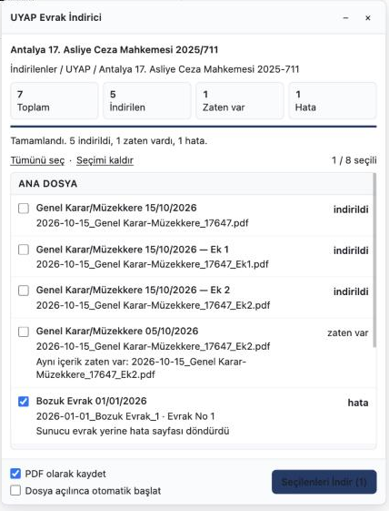

<div align="center">


# MSSoft UYAP Evrak İndirici

**UYAP Vatandaş Portalında açılan dava dosyasının bütün evraklarını ve eklerini tek seferde, düzenli klasörlere, PDF olarak ve tekrarsız indiren tarayıcı uzantısı.**

Evrak sekmesini aç, istediklerini seç, bir düğmeye bas. Gerisini uzantı yapar.

[](LICENSE)
[](https://github.com/lastref/mssoft-uyap-evrak-indirici/actions/workflows/ci.yml)
[](test/extension.test.js)
[](package.json)
[](SECURITY.md)
[](manifest.json)
[](#-kurulum)

[Kurulum](#-kurulum) · [Kullanım](#-kullanım) · [Dosya düzeni](#-dosya-düzeni) · [Tekrar indirmeme](#-tekrar-indirmeme) · [PDF](#-pdf-dönüştürme) · [Güvenlik](#-güvenlik) · [English](#-english)

</div>

<p align="center"></p>

---

## Sorun

Vatandaş Portal her evrakı tek tek sağ tık → Kaydet ile indirmeyi gerektirir. Yüzlerce evrakı olan bir dosyada bu saatler sürer, dosya adları anlamsızdır, hangisinin inip hangisinin inmediği takip edilemez ve evraklar UDF biçiminde gelir.

## Çözüm

Evrak sekmesi açıldığında sağ altta bir panel belirir. Dosyadaki tüm evraklar ve ekler sayfa sayfa toplanıp listelenir. Seçtikleriniz sırayla indirilir; her evrak **tarih, tür ve birim evrak numarasıyla** adlandırılır, mümkünse **PDF** olarak kaydedilir, daha önce inmiş olanlar **atlanır**. Panel sade: beyaz zemin, tek vurgu rengi, sistem fontu.

## Özellikler

- **Tam liste.** Portalın sayfalara böldüğü evrak ağacı bütünüyle çekilir; ekler ana evrakın altında, talimat dosyası gibi alt dosyalar kendi başlığında görünür.
- **Seçmeli indirme.** Her satırda tik kutusu; Tümünü seç / Seçimi kaldır; "Seçilenleri İndir (n)". Hiçbir şey kendiliğinden başlamaz; isteyen "Dosya açılınca otomatik başlat" seçeneğini açar.
- **Okunur adlar.** `2026-10-15_Genel Karar-Müzekkere_17647.pdf`. Tarih başta olduğu için dosyalar kronolojik sıralanır; ekler `_Ek1`, `_Ek2`.
- **PDF olarak kaydet.** Portalın kendi dönüştürme ucu kullanılır; PDF alınamazsa evrak ham biçimiyle iner.
- **Üç katmanlı tekrar koruması.** Liste tekilleştirme, dosya adı kontrolü, SHA-256 içerik kontrolü. Aynı evrak ikinci kez diske yazılmaz, satırda hangi dosyayla çakıştığı görünür.
- **Canlı takip.** Her satır "sırada → indirildi / zaten var / hata" olarak güncellenir; hata satırında neden yazılır, satır seçili kalır, yeniden denenir. Durdur süren indirmeyi bitirip kalanı keser.
- **Sıfır bağımlılık, UYAP dışına sıfır trafik, üç izin.** Ayrıntı [Güvenlik](#-güvenlik) bölümünde.

## 🚀 Kurulum

### Paketli sürüm

1. [Releases](https://github.com/lastref/mssoft-uyap-evrak-indirici/releases/latest) sayfasından `mssoft-uyap-evrak-indirici-<sürüm>.zip` dosyasını indirip açın.
2. Tarayıcıda `chrome://extensions` (Brave: `brave://extensions`, Edge: `edge://extensions`) adresini açın.
3. Sağ üstten **Geliştirici modu**'nu açın.
4. **Paketlenmemiş öğe yükle**'ye basın, açtığınız klasörü seçin.

### Kaynaktan

```bash
git clone https://github.com/lastref/mssoft-uyap-evrak-indirici.git
```

Sonra yukarıdaki 2–4. adımlar. Güncelleme için klasörü yenisiyle değiştirip uzantı sayfasında **Yeniden yükle** demeniz yeterli.

Chrome, Brave, Edge, Opera, Arc ve Vivaldi'de çalışır; **Chromium 110 veya üstü** gerekir. Firefox desteklenmez (Manifest V3 `downloads` davranışı farklıdır).

## 📋 Kullanım

1. Vatandaş Portal'a giriş yapın. **Sorgulama İşlemleri → Dosya Sorgulama** ile davayı bulun, **Dosya Görüntüle** deyin.
2. Açılan pencerede **Evrak** sekmesine tıklayın.
3. Sağ altta panel belirir. Tüm evraklar tik kutularıyla listelenir; daha önce inmiş olanlar "zaten var" olarak işaretli ve tiki kaldırılmış gelir.
4. İstediklerinizi seçin ve **Seçilenleri İndir** düğmesine basın.

Her satırda evrakın adı ve tarihi, altında diske yazılacak dosya adı, birim evrak numarası ve gönderen birim görünür. "Zaten var" olan bir evrakı yeniden indirmek için tikini işaretlemeniz yeterli.

| Seçenek | Varsayılan | Açıklama |
|---|---|---|
| PDF olarak kaydet | açık | Portalın kendi dönüştürme ucu kullanılır. PDF alınamazsa evrak ham biçimiyle iner. |
| Dosya açılınca otomatik başlat | kapalı | Evrak sekmesi yüklenir yüklenmez inmemiş olanların tümünü indirir. |

## 📁 Dosya düzeni

```
İndirilenler/
└── UYAP/
    └── Antalya 17. Asliye Ceza Mahkemesi 2025-711/
        ├── 2025-09-02_Tensip Zaptı_5.pdf
        ├── 2026-10-15_Genel Karar-Müzekkere_17647.pdf
        ├── 2026-10-15_Genel Karar-Müzekkere_17647_Ek1.pdf
        ├── 2026-10-15_Genel Karar-Müzekkere_17647_Ek2.pdf
        └── 2026-13 (Talimat Dosyası)/
            └── 2026-02-18_Adli Tıptan Rapor Talebi_2211.pdf
```

- Klasör adı: mahkeme adı ve esas numarası.
- Dosya adı: `onay tarihi_evrak türü_birim evrak no`.
- Ekler ana evrakın adına `_Ek1`, `_Ek2` eklenerek adlanır.
- Alt dosyalar kendi alt klasörüne iner.

Tarayıcınızın indirme konumunu değiştirdiyseniz `UYAP` klasörü oraya açılır.

## 🔁 Tekrar indirmeme

Üç katman birlikte çalışır:

1. **Liste.** Portal aynı evrakı "Dosyaya Eklenen Son 20 Evrak" altında ve kendi türünün altında iki kez gösterir. Birim evrak no, tarih ve tür ile tekilleştirilir.
2. **Dosya adı.** İndirmeden önce uzantının kaydına ve tarayıcının indirme geçmişine bakılır. Dosya diskte duruyorsa sunucuya istek atılmaz.
3. **İçerik.** İnen her dosyanın SHA-256 özeti tutulur. Aynı dava klasöründe aynı özetli bir dosya varsa yenisi yazılmaz; satırda "Aynı içerik zaten var: <dosya>" görünür.

Bir dosyayı silerseniz bir sonraki çalıştırmada yeniden iner.

## 📄 PDF dönüştürme

UYAP evrakları çoğunlukla UDF biçimindedir. Portal, evrakı tarayıcıda önizlerken sunucuda PDF'e çevirir. Uzantı aynı ucu kullanır: PDF alınabiliyorsa `.pdf`, alınamıyorsa evrak ham haliyle (`.udf`, `.tif` vb.) kaydedilir. Dönüştürme sunucuda yapılır; uzantı UDF'yi kendisi çevirmez. UDF dosyalarını UYAP Doküman Editörü açar.

## 🔒 Güvenlik

- Yalnızca `https://vatandas.uyap.gov.tr/main/jsp/vatandas/*` sayfalarında çalışır.
- İstekler, tarayıcınızda zaten açık olan oturumla doğrudan UYAP sunucusuna gider. Üçüncü taraf, telemetri, analitik yoktur.
- Diske yazma tarayıcının kendi indirme mekanizmasıyla yapılır; uzantının dosya sistemine serbest erişimi yoktur. Her yol bileşeni doğrulanır, dosya uzantısı yalnızca bilinen listeden seçilir, hata sayfaları diske değmez.
- Saklanan tek şey indirilen dosyaların adı, kimliği ve içerik özetidir. Evrak içeriği saklanmaz.

İzinler: `downloads` (diske yazmak), `storage` (indirilenlerin kaydı), `scripting` (dosya kimliğini sayfadan okumak için yedek yol). On korumanın tamamı, tehdit modeli ve zafiyet bildirimi için [SECURITY.md](SECURITY.md).

## 🛠 Sorun giderme

| Belirti | Ne yapmalı |
|---|---|
| Panel çıkmıyor | Evrak sekmesinin yüklendiğinden emin olun. Sayfayı yenileyip tekrar deneyin. Uzantı sayfasında **Yeniden yükle** deyin. |
| "Oturum düşmüş" | Portaldan çıkıp yeniden giriş yapın, davayı tekrar açın. |
| "Sunucu evrak yerine hata sayfası döndürdü" | Evrak portal tarafından o an verilemedi. Satır seçili kalır; biraz sonra tekrar deneyin. |
| Dosyalar `.udf` iniyor | Sunucu o evrak için PDF üretemedi. UDF dosyalarını UYAP Doküman Editörü açar. |
| Hata ayrıntısı | Uzantı sayfasında **service worker** bağlantısına tıklayın; konsolda hata görünür. |

## 🧑‍💻 Geliştirme

```
manifest.json        MV3 bildirimi
content.js           sayfa betiği: ağacı toplar, paneli çizer, evrakları çeker ve özetler
background.js        arka plan servisi: yol doğrulama, diske yazma, kayıt
panel.css            panel stilleri
icons/               simgeler ve üretici betik (make_icons.py, bağımlılık yok)
test/                node --test paketi ve sahte UYAP sunucusu
scripts/package.js   dağıtım zip'i
```

```bash
npm test          # sözdizimi denetimi + 15 test
npm run package   # dist/mssoft-uyap-evrak-indirici-<sürüm>.zip
npm run fixture   # http://localhost:8765/main/jsp/vatandas/index.jsp — gerçek portala girmeden arayüz
```

Sahte sunucu `chrome.*` API'sini taklit eder, `content.js` ve `panel.css`'i doğrudan yükler; PDF, UDF, hata ve aynı-içerik senaryoları hazırdır. Çalışma zamanı bağımlılığı yoktur; `package.json` yalnızca test ve paketleme içindir.

Katkı: hata bildirimi ve çekme istekleri açıktır. Değişiklik yapmadan önce bir konu açıp kısaca anlatmanız yeterli. Sürüm notları [CHANGELOG.md](CHANGELOG.md) içinde.

## ⚖️ Yasal uyarı

Bu proje T.C. Adalet Bakanlığı ya da UYAP ile ilişkili değildir, resmi bir ürün değildir. Yalnızca kendi hesabınızla erişebildiğiniz evrakları indirir; portalın kullanım koşullarına uymak kullanıcının sorumluluğundadır. Portal arayüzü değişirse uzantı çalışmayabilir.

## 📜 Lisans

[Apache-2.0](LICENSE) © 2026 MSSoft. Bkz. [NOTICE](NOTICE).

---

## 🇬🇧 English

**MSSoft UYAP Evrak İndirici** is a Chromium extension for the UYAP Citizen Portal (Türkiye's national judiciary portal). When you open a case file's document tab, a panel lists every document and attachment across all pages. Pick the ones you want and download them in one go.

- Files are named `date_type_documentNo.ext` and saved under `Downloads/UYAP/<Court CaseNo>/`; attachments get `_Ek1`, `_Ek2`; sub-cases get their own folder.
- Documents are saved as PDF when the portal's own preview endpoint returns one; otherwise in their native format (`.udf`, `.tif`).
- Three layers of de-duplication: tree de-dup by document number + date + type, filename check against the extension's records and the browser's download history, and SHA-256 content check so the same bytes are never written twice.
- Nothing starts automatically unless you turn the option on. Rows update live; failed rows show the reason and stay selected for retry.
- Zero runtime dependencies, zero traffic outside UYAP, three permissions. See [SECURITY.md](SECURITY.md).

Install: download the zip from Releases, open `chrome://extensions`, enable Developer mode, **Load unpacked**, select the folder. Chromium 110+.

Not affiliated with the Ministry of Justice or UYAP. Licensed under Apache-2.0.
